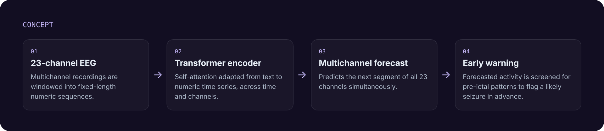

# Early Detection of Epileptic Seizures with a Transformer

**TEKNOFEST 2025, Technology for Humanity: Health Technologies, finalist (3,216 teams)**
Team **AIMed** · Advisor: **Prof. Dr. Ufuk Sakarya** · My role: **the team's only software developer**

## Idea

Seizure detection usually reacts after a seizure has started. This project tries to **see it coming**. Our model looks at recent multichannel EEG, **forecasts what the next segment will look like on every channel**, and raises a warning when the forecast points to an upcoming seizure.

## What I did

- Adapted the **Transformer** architecture, originally built for text, to **numeric time series**.
- The model takes **23-channel EEG** and **forecasts all 23 channels at the same time**, so it learns how the channels relate instead of treating each one separately.
- Built the forecast-based **early-warning** step that flags a likely seizure in advance.
- Handled all of the project's software as the team's only developer.

## Recognition

- 🏅 **TEKNOFEST 2025 finalist** in the Health Technologies category, chosen from 3,216 teams
- 📰 Covered by **Anadolu Ajansı**, **Milliyet** and five other news sites

## Stack

`Python` · `Transformer` · `time-series forecasting` · `EEG signal processing`

---

Source code and data are not published. The diagram above is a concept overview. Built by <a href="https://github.com/mtaiea">Mustafa Talha Arı</a>.
